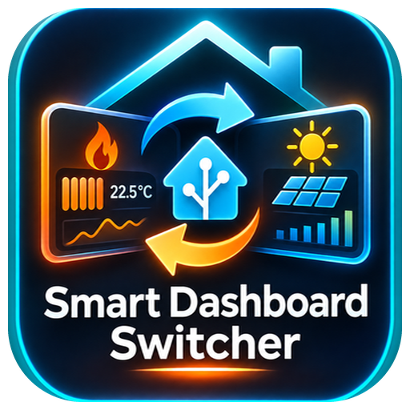

# Smart Dashboard Switcher

Home-Assistant-Integration, die auf einem Wand-Tablet oder Info-Display **automatisch zwischen zwei Dashboard-Ansichten umschaltet**, je nachdem, ob eine Entität **an** oder **aus** ist.

Beispiel: Läuft die Kesselpumpe, wird das Heizungs-Dashboard angezeigt, sonst das Solar-Dashboard.

## Funktionen

- Umschalten anhand von `switch`, `binary_sensor` oder `input_boolean`
- Getrennte Verzögerung für EIN und AUS, damit kurzes Takten nicht ständig umschaltet. Ein Countdown zeigt den bevorstehenden Wechsel an.
- Die Karten der Ziel-Ansicht werden direkt gerendert, ohne iframe. Klassische Ansichten und Sections-Ansichten werden unterstützt.
- Legt automatisch ein eigenes Dashboard an (`/dashboard-info-display/0`), das du im Benutzerprofil als Standard-Dashboard wählen kannst
- Mehrere Instanzen möglich, z. B. für verschiedene Tablets
- Einrichtung komplett über die Oberfläche, kein YAML nötig

## Voraussetzungen

- Home Assistant **2025.1** oder neuer
- Ab **2026.3** wird das Integrations-Icon lokal angezeigt (Ordner `brand/`).
- Lovelace-Ressourcen im Modus „Speicher“ (Standard). Bei YAML-Ressourcen siehe [Fehlerbehebung](#fehlerbehebung).

## Installation

### Über HACS (empfohlen)

1. HACS öffnen → oben rechts **⋮** → **Benutzerdefinierte Repositories**
2. Repository: `https://github.com/Darkwulf183/smart-dashboard-switcher`, Typ: **Integration** → **Hinzufügen**
3. Nach **Smart Dashboard Switcher** suchen → **Herunterladen**
4. Home Assistant **neu starten**

### Manuell

1. Den Ordner `custom_components/smart_dashboard_switcher` aus dem [neuesten Release](https://github.com/Darkwulf183/smart-dashboard-switcher/releases) nach `/config/custom_components/` kopieren
2. Home Assistant **neu starten**

## Einrichtung

1. **Einstellungen → Geräte & Dienste → Integration hinzufügen → Smart Dashboard Switcher**

   

2. Ausfüllen:

   | Feld | Bedeutung | Beispiel |
   |---|---|---|
   | In Seitenleiste anzeigen | Zusätzlicher Eintrag „Info Display“ in der Seitenleiste | an |
   | Sidebar-Pfad | Kurzname dieser Instanz (nur `a-z`, `0-9`, `-`, `_`) | `info-display` |
   | Ventil-Entität | Entität, deren Zustand den Wechsel auslöst | `switch.kessel_pumpe_an_aus` |
   | Dashboard bei EIN | Pfad der Ansicht bei Zustand `on` | `/heizung/0` |
   | Dashboard bei AUS | Pfad der Ansicht bei Zustand `off` | `/solar/0` |
   | Verzögerung EIN / AUS | Sekunden bis zum Umschalten | `30` / `120` |

   Pfade sind die URL ohne Server, also das, was im Browser hinter `http://homeassistant:8123` steht. Für das Standard-Dashboard: `/lovelace/0`.

3. **Home Assistant noch einmal neu starten.** Erst danach erscheint das neue Dashboard in der Dashboard-Liste und im Profil. Bis dahin bitte keine anderen Dashboards anlegen oder bearbeiten.
4. Auf dem Tablet: **Profil → Dashboard → „Info Display“** auswählen
5. Optional: **Konfigurieren → In Seitenleiste anzeigen** ausschalten

Einstellungen lassen sich später jederzeit unter **Konfigurieren** ändern, ohne Neustart.

## Fehlerbehebung

- **„Custom element doesn't exist: smart-dashboard-switcher-card“:** Die Ressource fehlt, meist weil die Ressourcen per YAML verwaltet werden. Dann unter **Einstellungen → Dashboards → ⋮ → Ressourcen** (oder in YAML) `/smart_dashboard_switcher/switcher.js` als **JavaScript-Modul** eintragen.
- **Nach einem Update noch die alte Version:** Browser-Cache leeren (Strg+F5). In der Companion-App: **Einstellungen → Companion App → Problembehandlung → Frontend-Cache zurücksetzen**.
- **„Ansicht … nicht gefunden“:** Den Pfad prüfen. Die Zahl am Ende ist der Index (`0` = erste Ansicht) oder der eigene Pfad der Ansicht.
- **„Dashboard … was customized; not overwriting“ im Protokoll:** Du hast das automatisch erstellte Dashboard verändert. Die Integration überschreibt es dann absichtlich nicht mehr.
- Weitere Details stehen im Protokoll unter **Einstellungen → System → Protokolle**, Suchbegriff `smart_dashboard_switcher`.

## Deinstallieren

1. Integration unter **Geräte & Dienste** löschen
2. Das Dashboard **Info Display** unter **Einstellungen → Dashboards** bei Bedarf von Hand löschen
3. Über HACS entfernen oder den Ordner löschen, dann neu starten

## Mitwirkende

| | Rolle |
|---|---|
| [@Darkwulf183](https://github.com/Darkwulf183) | Idee, Entwicklung, Tests, Maintainer |
| [ChatGPT](https://chatgpt.com) (OpenAI) | Entwicklung der Integration und des Icons |
| [Claude](https://claude.ai) (Anthropic) | Code-Review, Fehlerbehebung, HACS-Vorbereitung, Repository-Einrichtung |

## Lizenz

[MIT](LICENSE)
